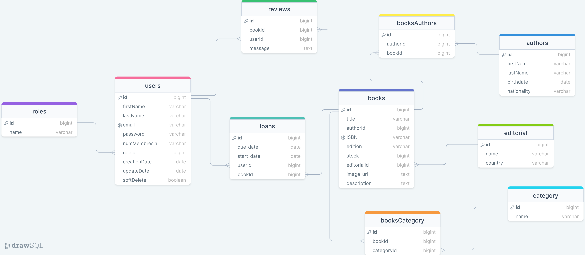

# Alkemy Project - Library

## Description

This project is a backend application for managing a library, built with Node.js, Express, MySQL, and Sequelize as the ORM. The application allows users to manage book loans, post reviews, receive email and real-time notifications, and chat with other connected users.

## Installation

Clone the repository and run npm install to install dependencies:

`$ git clone https://github.com/macarenabarrios/proyecto-alkemy.git`
`$ cd proyecto-alkemy`
`$ npm install`

## Configuration

Create a .env file in the project root with the following environment variables:

`GMAIL_USER=tu_email@gmail.com`

`GMAIL_PASS=tu_contraseña`

`DB_HOST=localhost`

`DB_USER=root`

`DB_PASS=tu_contraseña`

`DB_NAME=nombre_de_tu_base_de_datos`

`JWT_SECRET=tu_secreto_jwt`

## Execution

To start the server in development mode, run:

`$ npm run dev`

The server will run at http://localhost:3000.

## Testing Recommendation

Since this backend project doesn’t include a frontend, it’s highly recommended to use tools like Postman or Insomnia to test the API routes and functionality. These tools allow you to send HTTP requests and check responses, making development and debugging easier.

#### Postman

Postman is a popular API development tool that makes it easy to create, test, and document HTTP requests in a visual way.

##### Installation

You can download Postman [here](https://www.postman.com/downloads/).

##### Usage

1. **Create a New Collection: Group API routes into collections to keep them organized.**

Agrupa las rutas de la API en colecciones para mantenerlas organizadas.

2. **Create a New Request:**

   - Select the HTTP method (GET, POST, PUT, DELETE, etc.).

   - Enter the API URL.

   - Add any necessary headers (e.g., Content-Type: application/json).

   - Add the request body if needed (in JSON format).

3. **Send the Request:**

Click "Send" to submit the request and view the server's response.

4. **Save Requests:**

Save requests in the collection for easy reuse.

##### Sample Request

Suppose you want to test user creation at the /api/auth route with a POST method. Here’s an example:

**Create a New Request:**

Method: POST
URL: http://localhost:3000/api/auth/register
Body:
    
    { 
      "firstname": "John",

      "lastname": "Doe",

      "email": "johndoe@email.com",

      "password": "password123",

      "membershipNumber": "M131a9"
	 }

Then, **send the request** and verify the response.

## Models and relationships

The project includes the following models and their relationships:

- **User**: Represents application users.

- **Role**: Represents user roles.

- **Author**: Represents book authors.

- **Book**: Represents books.

- **Category**: Represents book categories.

- **BookCategory**: Intermediate table for the many-to-many relationship between Book and Category.

- **Publisher**: Represents book publishers.

- **Library**: Represents user libraries.

- **Review**: Represents book reviews.

- **Loan**: Represents book loans.

- **Event**: Represents library events.

## Clean architecture

The project follows Clean Architecture principles, organizing responsibilities into well-defined layers: Controllers, Services, Repositories, and Models. This approach enhances code maintainability and scalability.

#### Routes

Routes are organized in the routes folder and follow a clean architecture by separating logic into controllers, services, and repositories.

#### Controllers

Controllers manage incoming HTTP requests and responses. They receive user inputs, process them (typically by calling services), and return appropriate responses.

Las rutas están organizadas en la carpeta `routes` y siguen una arquitectura limpia dividiendo la lógica en controladores, servicios y repositorios.

#### Services

Services encapsulate business logic and coordinate operations between controllers and repositories. This layer ensures business rules are applied correctly.

#### Repositories

Repositories handle data access operations. They are responsible for communicating with the database through the models, encapsulating SQL or ORM queries.

#### Models

Models represent the structure and relationships of data in the database. We use Sequelize to define these models and their associations.

#### Layer Integration

- **Controllers**: Receive client requests, validate them, and call the necessary services.
- **Services**: Contain business logic and coordinate actions between controllers and repositories.
- **Repositories**: Perform data access operations, communicating with the database through models.
- **Models**: Define data structure and relationships between database tables.

This structure ensures a clear separation of responsibilities, making the project easier to test, maintain, and scale. By following Clean Architecture, we ensure each layer has a single responsibility, promoting a more organized and manageable codebase.

## Features

#### Email Notifications

Emails are sent when new books are added, as well as when books from new authors are added, using `nodemailer`. The following functions are used to send emails and notifications:

- **sendEmail**: Sends emails.

- **sendLoanNotification**: Notifies about new loans.

- **sendNewNotification**: Notifies about new books and new authors.

#### Real-Time Notifications and Chat

The project uses `socket.io` to allow users to receive real-time notifications and chat with other connected users:

- **configureSocketIO**: Configures Socket.IO with the server.

- **notifyNewBookAvailable**: Notifies when a new book is available.

- **chat message**: Handles real-time chat messages.

*This project provides a solid foundation for library management, integrating advanced features such as real-time notifications and a system for book loans and reviews.*
